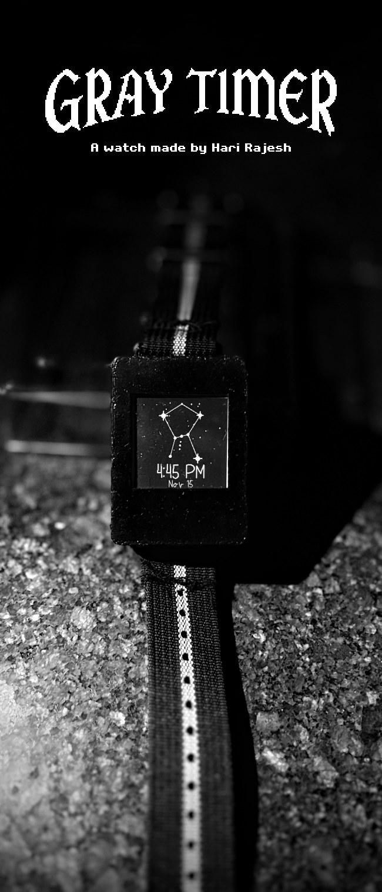
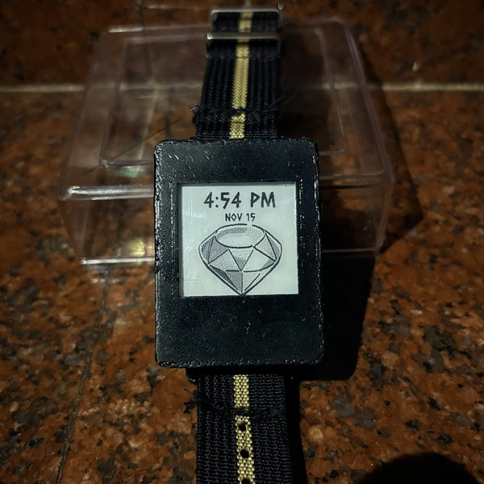
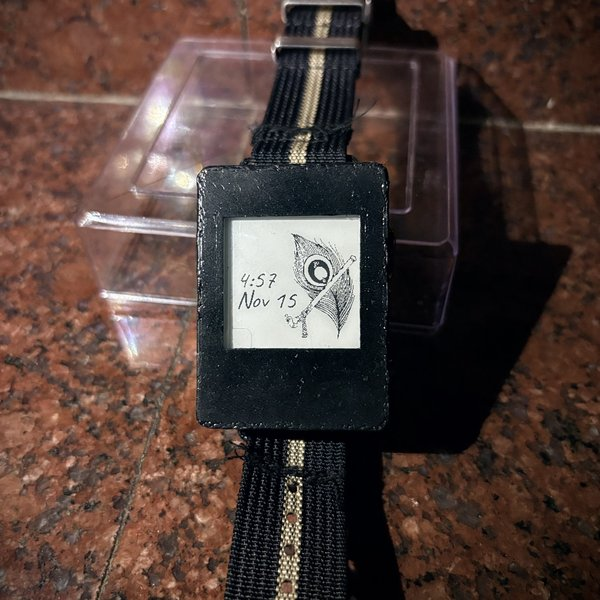
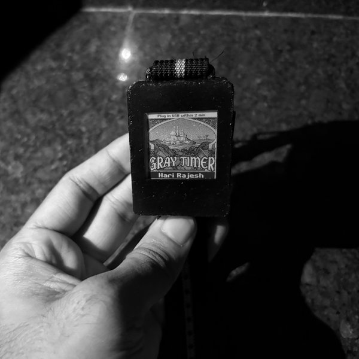

# DIY . watch . eInk . NFC

- GrayTimer is a fully customizable watch powered by my two most favorite technologies - eInk and NFC!
- Solder the whole thing easily, rather than building a PCB.
- 3D print yourself a case. Sew up a regular strap. Stuff everything in.
- Tap your phone to pick a watch face, set the time, clear ghosting, or get ready for a firmware update, all without opening the case.
- Run Claude Code, Codex or any AI coding agent, to assist you develop code or generate watch faces
- Watch a demo - [https://www.youtube.com/watch?v=rnAYJC3mgms](https://www.youtube.com/watch?v=rnAYJC3mgms)
- Build Guide (Hackster) - [https://www.hackster.io/varahan/graytimer-nfc-eink-watch-06e3d7](https://www.hackster.io/varahan/graytimer-nfc-eink-watch-06e3d7)
- Medium (The story behind) - [https://medium.com/@haricane8133/gray-timer-the-story-4ba7ca0a75e1](https://www.hackster.io/varahan/graytimer-nfc-eink-watch-06e3d7)

<table>
  <tr>
    <td rowspan="3" align="center">
      
    </td>
    <td align="center" valign="top">
      <br/>
      A new face every 10 minutes
    </td>
  </tr>
  <tr>
    <td align="center" valign="top">
      <br/>
      Line art looks crisp on e-paper
    </td>
  </tr>
  <tr>
    <td align="center" valign="top">
      <br/>
      Ready for an update with one tap
    </td>
  </tr>
</table>

### Checkout
- [All watchfaces / NFC usage](docs/CATALOG.md)
- [Documentation / Build Guide](docs/README.md)

---

## What's inside

```
graytimer/
├── graytimer.ino           # The sketch: settings, the list of faces, sleep and NFC
├── myutils.h / .cpp        # Drawing the time on the display
├── WatchFace.h             # What a watchface is made of
├── RTCManager.h            # The clock chip
├── dfu_screen.h            # The screen shown while waiting for an upload
│
├── myfonts/                # Fonts
├── mywatchfaces/           # One file per watchface
│
├── hardware/               # Case models to 3D print
├── watchfaceutils/         # Python tools to make and preview watchfaces
├── docs/                   # Catalog, gallery, hardware guide and API
└── AGENTS.md               # A short guide for AI coding agents
```

---

Thanks to @vu2ow for the help and inspiration behind all my projects!
