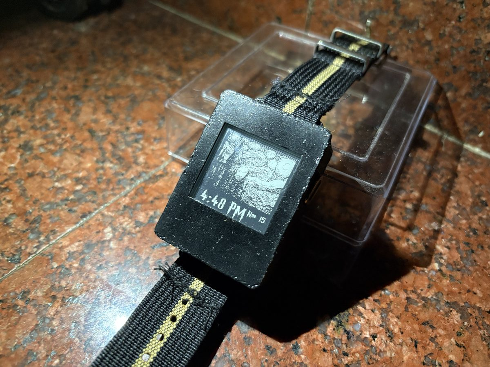
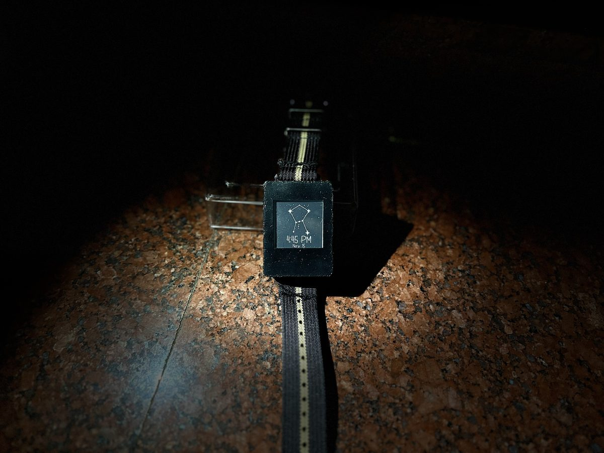
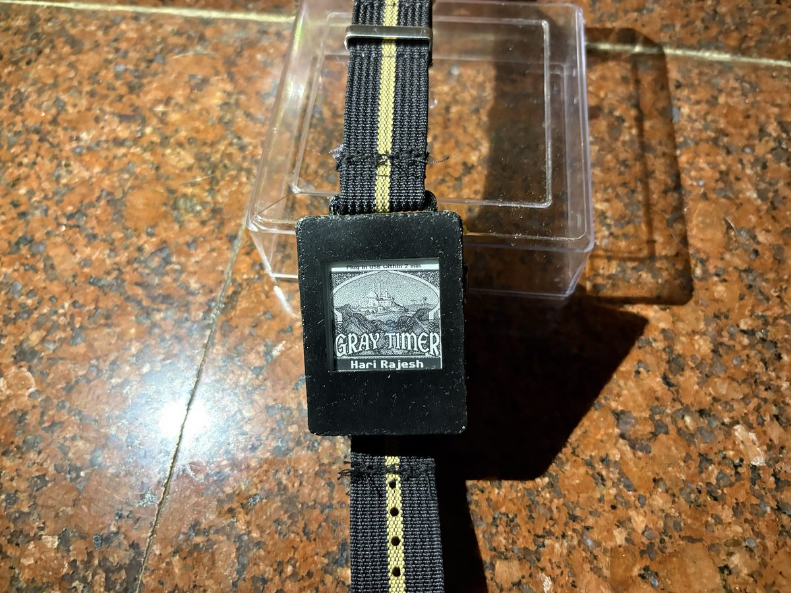

# Gallery

Photos of the watch. Every watchface, with its number for picking it from a
phone, is in the [catalog](CATALOG.md). To see how the watch came together,
read [the build story](BUILD.md).

## Gray Timer V2

  

<table>
  <tr>
    <td align="center" valign="top" width="50%">
       
      A painting, in black and white
    </td>
    <td align="center" valign="top" width="50%">
       
      In the spotlight
    </td>
  </tr>
  <tr>
    <td align="center" valign="top" width="50%">
       
      The firmware update screen
    </td>
  </tr>
</table>

## The first Gray Timer

The first watch, in its orange case.

<table>
  <tr>
    <td align="center" width="50%">
      
    </td>
    <td align="center" width="50%">
      
    </td>
  </tr>
  <tr>
    <td align="center" width="50%">
      
    </td>
    <td align="center" width="50%">
      
    </td>
  </tr>
</table>

## In motion

The two kinds of refresh, filmed on the first watch.

<table>
  <tr>
    <td align="center" valign="top" width="50%">
       
      <b>Full refresh</b> 
      A clean redraw when the face changes
    </td>
    <td align="center" valign="top" width="50%">
       
      <b>Partial refresh</b> 
      The quick one, every minute
    </td>
  </tr>
</table>
