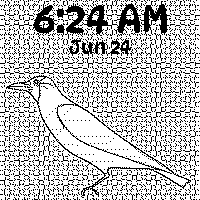
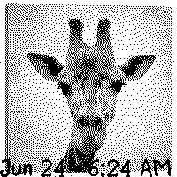

# Gallery

<table>
   <tr>
   <td align="center" width="45%">
      <br/>
    </td>
    <td align="center" width="45%">
      <br/>
    </td>
  </tr>
  <tr>
    <td align="center" width="45%">
      <br/>
    </td>
    <td align="center" width="45%">
      <br/>
    </td>
  </tr>
  <tr>
    <td align="center" width="45%">
      <br/>
    </td>
    <td align="center" width="45%">
      <br/>
    </td>
  </tr>
</table>


Browse all 115 available watchfaces for the e-paper watch project.

The number before each name is the face's catalog number: write it to the
watch from a phone over NFC to show that face. The [catalog](CATALOG.md)
explains how.

---

Faces marked with * are procedurally generated by `watchfaceutils/generate_geometric.py` (pure 1-bit shapes, no source artwork).

<!-- gallery:start -->
## Star Wars Collection

<table>
  <tr>
    <td align="center" width="33%">
      <br/>
      <b>1 · AT-AT</b>
    </td>
    <td align="center" width="33%">
      <br/>
      <b>2 · AT-DP</b>
    </td>
    <td align="center" width="33%">
      <br/>
      <b>3 · B1 Battle Droid</b>
    </td>
  </tr>
  <tr>
    <td align="center" width="33%">
      <br/>
      <b>41 · Stormtrooper 2</b>
    </td>
    <td align="center" width="33%">
      <br/>
      <b>42 · Stormtrooper 3</b>
    </td>
    <td align="center" width="33%">
      <br/>
      <b>48 · X-Wing</b>
    </td>
  </tr>
  <tr>
    <td align="center" width="33%">
      <br/>
      <b>50 · TIE Fighter*</b>
    </td>
    <td align="center" width="33%">
      <br/>
      <b>51 · Death Star*</b>
    </td>
    <td align="center" width="33%">
      <br/>
      <b>63 · Lightsaber*</b>
    </td>
  </tr>
  <tr>
    <td align="center" width="33%">
      <br/>
      <b>71 · R2-D2*</b>
    </td>
    <td align="center" width="33%">
      <br/>
      <b>72 · Millennium Falcon*</b>
    </td>
    <td align="center" width="33%">
      <br/>
      <b>88 · Darth Vader*</b>
    </td>
  </tr>
  <tr>
    <td align="center" width="33%">
      <br/>
      <b>89 · Mandalorian*</b>
    </td>
  </tr>
</table>

## Harry Potter Collection

<table>
  <tr>
    <td align="center" width="33%">
      <br/>
      <b>15 · Harry Potter</b>
    </td>
    <td align="center" width="33%">
      <br/>
      <b>17 · Hogwarts</b>
    </td>
    <td align="center" width="33%">
      <br/>
      <b>18 · Hogwarts 2</b>
    </td>
  </tr>
  <tr>
    <td align="center" width="33%">
      <br/>
      <b>19 · Hogwarts 3</b>
    </td>
    <td align="center" width="33%">
      <br/>
      <b>20 · Hogwarts 4</b>
    </td>
    <td align="center" width="33%">
      <br/>
      <b>40 · Sorting Hat</b>
    </td>
  </tr>
  <tr>
    <td align="center" width="33%">
      <br/>
      <b>52 · Deathly Hallows*</b>
    </td>
    <td align="center" width="33%">
      <br/>
      <b>61 · Glasses & Scar*</b>
    </td>
    <td align="center" width="33%">
      <br/>
      <b>62 · Golden Snitch*</b>
    </td>
  </tr>
  <tr>
    <td align="center" width="33%">
      <br/>
      <b>73 · Hedwig*</b>
    </td>
  </tr>
</table>

## Club Penguin Collection

<table>
  <tr>
    <td align="center" width="33%">
      <br/>
      <b>21 · Card Jitsu 1</b>
    </td>
    <td align="center" width="33%">
      <br/>
      <b>22 · Card Jitsu 2</b>
    </td>
    <td align="center" width="33%">
      <br/>
      <b>23 · Card Jitsu 3</b>
    </td>
  </tr>
  <tr>
    <td align="center" width="33%">
      <br/>
      <b>24 · Card Jitsu 4</b>
    </td>
    <td align="center" width="33%">
      <br/>
      <b>25 · Card Jitsu 5</b>
    </td>
    <td align="center" width="33%">
      <br/>
      <b>39 · Sensei</b>
    </td>
  </tr>
  <tr>
    <td align="center" width="33%">
      <br/>
      <b>16 · Herbert</b>
    </td>
    <td align="center" width="33%">
      <br/>
      <b>74 · Penguin*</b>
    </td>
  </tr>
</table>

## Animals

<table>
  <tr>
    <td align="center" width="33%">
      <br/>
      <b>5 · Bird</b>
    </td>
    <td align="center" width="33%">
      <br/>
      <b>6 · Bird 2</b>
    </td>
    <!-- <td align="center" width="33%">
      <br/>
      <b>Crow</b>
    </td> -->
  </tr>
  <tr>
    <td align="center" width="33%">
      <br/>
      <b>10 · Dog</b>
    </td>
    <!-- <td align="center" width="33%">
      <br/>
      <b>Giraffe</b>
    </td> -->
    <td align="center" width="33%">
      <br/>
      <b>27 · Macaw</b>
    </td>
  </tr>
  <tr>
    <td align="center" width="33%">
      <br/>
      <b>31 · Peacock</b>
    </td>
    <td align="center" width="33%">
      <br/>
      <b>32 · Peacock 3</b>
    </td>
    <td align="center" width="33%">
      <br/>
      <b>49 · Zebra</b>
    </td>
  </tr>
  <tr>
    <td align="center" width="33%">
      <br/>
      <b>82 · Whale*</b>
    </td>
    <td align="center" width="33%">
      <br/>
      <b>92 · Cat*</b>
    </td>
  </tr>
</table>

## Other Characters

<table>
  <tr>
    <td align="center" width="33%">
      <br/>
      <b>4 · Ben 10</b>
    </td>
    <td align="center" width="33%">
      <br/>
      <b>7 · Bugs Bunny</b>
    </td>
    <!-- <td align="center" width="33%">
      <br/>
      <b>Claw</b>
    </td> -->
  </tr>
  <tr>
    <td align="center" width="33%">
      <br/>
      <b>8 · Claw 2</b>
    </td>
    <td align="center" width="33%">
      <br/>
      <b>9 · Claw 3</b>
    </td>
    <td align="center" width="33%">
      <br/>
      <b>45 · Tom (Tom & Jerry)</b>
    </td>
  </tr>
  <tr>
    <td align="center" width="33%">
      <br/>
      <b>28 · Mike Wazowski</b>
    </td>
    <td align="center" width="33%">
      <br/>
      <b>43 · Sulley</b>
    </td>
    <td align="center" width="33%">
      <br/>
      <b>33 · Pegasus</b>
    </td>
  </tr>
  <tr>
    <td align="center" width="33%">
      <br/>
      <b>35 · Penguins of Madagascar</b>
    </td>
    <td align="center" width="33%">
      <br/>
      <b>34 · Penguin Beatles</b>
    </td>
    <td align="center" width="33%">
      <br/>
      <b>90 · Boo's Door*</b>
    </td>
  </tr>
</table>

## Horizon Zero Dawn

<table>
  <tr>
    <td align="center" width="33%">
      <br/>
      <b>47 · Walker</b>
    </td>
    <td align="center" width="33%">
      <br/>
      <b>83 · Thunderjaw*</b>
    </td>
    <td align="center" width="33%">
      <br/>
      <b>84 · Watcher*</b>
    </td>
  </tr>
  <tr>
    <td align="center" width="33%">
      <br/>
      <b>85 · Sawtooth*</b>
    </td>
    <td align="center" width="33%">
      <br/>
      <b>86 · Stormbird*</b>
    </td>
    <td align="center" width="33%">
      <br/>
      <b>87 · Strider*</b>
    </td>
  </tr>
</table>

## Hades

<table>
  <tr>
    <td align="center" width="33%">
      <br/>
      <b>96 · Nectar*</b>
    </td>
    <td align="center" width="33%">
      <br/>
      <b>97 · Ambrosia*</b>
    </td>
    <td align="center" width="33%">
      <br/>
      <b>98 · Darkness*</b>
    </td>
  </tr>
  <tr>
    <td align="center" width="33%">
      <br/>
      <b>99 · Chthonic Key*</b>
    </td>
    <td align="center" width="33%">
      <br/>
      <b>100 · Titan Blood*</b>
    </td>
    <td align="center" width="33%">
      <br/>
      <b>101 · Diamond*</b>
    </td>
  </tr>
  <tr>
    <td align="center" width="33%">
      <br/>
      <b>102 · Gemstones*</b>
    </td>
    <td align="center" width="33%">
      <br/>
      <b>103 · Charon's Obol*</b>
    </td>
    <td align="center" width="33%">
      <br/>
      <b>104 · Centaur Heart*</b>
    </td>
  </tr>
  <tr>
    <td align="center" width="33%">
      <br/>
      <b>105 · Pom of Power*</b>
    </td>
    <td align="center" width="33%">
      <br/>
      <b>106 · Daedalus Hammer*</b>
    </td>
    <td align="center" width="33%">
      <br/>
      <b>107 · Old Spiked Collar*</b>
    </td>
  </tr>
  <tr>
    <td align="center" width="33%">
      <br/>
      <b>108 · Pierced Butterfly*</b>
    </td>
    <td align="center" width="33%">
      <br/>
      <b>109 · Owl Pendant*</b>
    </td>
    <td align="center" width="33%">
      <br/>
      <b>110 · Cosmic Egg*</b>
    </td>
  </tr>
  <tr>
    <td align="center" width="33%">
      <br/>
      <b>111 · Bone Hourglass*</b>
    </td>
    <td align="center" width="33%">
      <br/>
      <b>112 · Skull Earring*</b>
    </td>
    <td align="center" width="33%">
      <br/>
      <b>113 · Chthonic Coin Purse*</b>
    </td>
  </tr>
  <tr>
    <td align="center" width="33%">
      <br/>
      <b>114 · Eternal Rose*</b>
    </td>
    <td align="center" width="33%">
      <br/>
      <b>115 · Lucky Tooth*</b>
    </td>
  </tr>
</table>

## Music & Entertainment

<table>
  <tr>
    <td align="center" width="33%">
      <br/>
      <b>11 · Guitar 1</b>
    </td>
    <td align="center" width="33%">
      <br/>
      <b>12 · Guitar 2</b>
    </td>
    <td align="center" width="33%">
      <br/>
      <b>37 · PlayStation</b>
    </td>
  </tr>
  <tr>
    <td align="center" width="33%">
      <br/>
      <b>53 · Prism (Dark Side of the Moon)*</b>
    </td>
    <td align="center" width="33%">
      <br/>
      <b>57 · Vinyl*</b>
    </td>
    <td align="center" width="33%">
      <br/>
      <b>65 · Cassette*</b>
    </td>
  </tr>
  <tr>
    <td align="center" width="33%">
      <br/>
      <b>66 · Equalizer*</b>
    </td>
    <td align="center" width="33%">
      <br/>
      <b>75 · Headphones*</b>
    </td>
  </tr>
</table>

## Nature & Landscapes

<table>
  <tr>
    <td align="center" width="33%">
      <br/>
      <b>29 · Mountain 1</b>
    </td>
    <td align="center" width="33%">
      <br/>
      <b>30 · Mountain 2</b>
    </td>
    <td align="center" width="33%">
      <br/>
      <b>46 · Tree</b>
    </td>
  </tr>
  <tr>
    <td align="center" width="33%">
      <br/>
      <b>68 · Forest*</b>
    </td>
    <td align="center" width="33%">
      <br/>
      <b>70 · Waves*</b>
    </td>
    <td align="center" width="33%">
      <br/>
      <b>60 · Moon*</b>
    </td>
  </tr>
  <tr>
    <td align="center" width="33%">
      <br/>
      <b>77 · Hot-Air Balloon*</b>
    </td>
    <td align="center" width="33%">
      <br/>
      <b>78 · Lighthouse*</b>
    </td>
    <td align="center" width="33%">
      <br/>
      <b>94 · Sailboat*</b>
    </td>
  </tr>
</table>

## Space

<table>
  <tr>
    <td align="center" width="33%">
      <br/>
      <b>36 · Planets</b>
    </td>
    <td align="center" width="33%">
      <br/>
      <b>38 · Saturn</b>
    </td>
    <td align="center" width="33%">
      <br/>
      <b>54 · Orbits*</b>
    </td>
  </tr>
  <tr>
    <td align="center" width="33%">
      <br/>
      <b>55 · Orion*</b>
    </td>
    <td align="center" width="33%">
      <br/>
      <b>64 · Rocket*</b>
    </td>
    <td align="center" width="33%">
      <br/>
      <b>76 · UFO*</b>
    </td>
  </tr>
  <tr>
    <td align="center" width="33%">
      <br/>
      <b>91 · Astronaut*</b>
    </td>
  </tr>
</table>

## Cultural & Spiritual

<table>
  <tr>
    <td align="center" width="33%">
      <br/>
      <b>26 · Krishna</b>
    </td>
    <td align="center" width="33%">
      <br/>
      <b>44 · Thiruman</b>
    </td>
    <td align="center" width="33%">
      <br/>
      <b>56 · Kolam*</b>
    </td>
  </tr>
  <tr>
    <td align="center" width="33%">
      <br/>
      <b>67 · Mandala*</b>
    </td>
    <td align="center" width="33%">
      <br/>
      <b>79 · Diya*</b>
    </td>
    <td align="center" width="33%">
      <br/>
      <b>95 · Hari (Tamil)*</b>
    </td>
  </tr>
</table>

## Everyday Things

<table>
  <tr>
    <td align="center" width="33%">
      <br/>
      <b>80 · Coffee*</b>
    </td>
    <td align="center" width="33%">
      <br/>
      <b>81 · Bicycle*</b>
    </td>
    <td align="center" width="33%">
      <br/>
      <b>93 · Camera*</b>
    </td>
  </tr>
</table>

## Abstract & Patterns

<table>
  <tr>
    <td align="center" width="33%">
      <br/>
      <b>13 · haricane8133</b>
    </td>
    <td align="center" width="33%">
      <br/>
      <b>14 · Harley Davidson</b>
    </td>
    <td align="center" width="33%">
      <br/>
      <b>58 · Sunburst*</b>
    </td>
  </tr>
  <tr>
    <td align="center" width="33%">
      <br/>
      <b>59 · Minimal*</b>
    </td>
    <td align="center" width="33%">
      <br/>
      <b>69 · Dial*</b>
    </td>
  </tr>
</table>

<!-- gallery:end -->
---

## Creating Your Own Watchface

Want to add your own watchface? Check out the [Python tools documentation](README-STANDARD.md#creating-custom-watchfaces) for step-by-step instructions!

### Quick Start

```bash
cd watchfaceutils
python3 configure_watchface.py
```

The interactive tool will guide you through:
1. Selecting your artwork
2. Choosing fonts
3. Positioning text
4. Generating C++ code
5. Creating preview images

---

## Technical Details

- **Display**: 200x200 pixels, 1-bit monochrome
- **Format**: Percentage-based positioning (0-100%)
- **Fonts**: 66 custom fonts included
- **Layout Modes**: Single-line and two-line text layouts
- **Refresh**: Partial (fast) and full (ghosting-free) modes

For complete API documentation, see [README-DETAILED.md](README-DETAILED.md#watchface-class-structure).

---

**Total Watchfaces**: 115 and growing! 🎨
