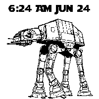
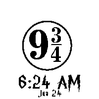
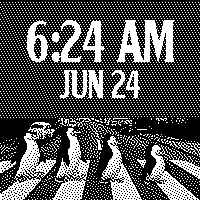
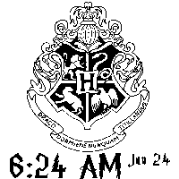
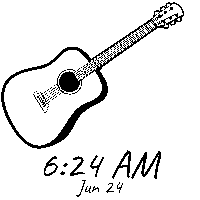

# E-Paper Watch Documentation

Complete documentation for the e-paper watch project.

---

## Documentation Index

- **[Watchface Gallery](GALLERY.md)** - Browse all 115 watchfaces with preview images
- **[Watchface Catalog](CATALOG.md)** - Face numbers, and how to pick a face or set the time from a phone over NFC
- **[WatchFace API Reference](API.md)** - Complete API documentation for creating custom watchfaces
- **[Hardware Guide](HARDWARE.md)** - Detailed hardware specifications, wiring, and assembly

---

## Features

- **Display**: 200×200 monochrome e-paper (1.54", 200 DPI)
- **Watchfaces**: 115+ pre-configured with custom fonts
- **Time Keeping**: RV-8803 RTC (±3ppm), wakes the MCU from System OFF every minute
- **NFC**: a phone writes a face number or the date and time with any NFC tag app; its field wakes the watch
- **Refresh Modes**: Partial (fast) and full (ghosting-free)
- **Development Tools**: Python scripts for creating custom watchfaces

---

## Configuration

### Main Settings

Edit `graytimer.ino` to customize behavior:

```cpp
// Enable/disable features
const bool ENABLE_WATCHFACE_CYCLING = true;  // Shuffle mode: new face every 10 mins
const bool ENABLE_PARTIAL_REFRESH = true;    // Fast updates
const bool ENABLE_SERIAL_DEBUG = false;      // Disable for battery life

// Timing
const uint8_t FULL_REFRESH_INTERVAL = 10;    // Minutes (10 = :00, :10, :20...)
```

### Power

There is nothing to tune for sleep: the watch sits in nRF52840 System OFF and
the RV-8803 wakes it once a minute through INT (D2), or a phone's NFC field
wakes it (sensing the field costs next to nothing). The display refreshes are
nearly the whole power budget, so the lever is `FULL_REFRESH_INTERVAL` (full
refreshes cost ~3× a partial one). Keep `ENABLE_SERIAL_DEBUG = false` for
deployment. See [Hardware Guide](HARDWARE.md#power-consumption).

---

## Creating Custom Watchfaces

### Using Python Tools (Recommended)

```bash
cd watchfaceutils

# Interactive configurator with live preview
python3 configure_watchface.py

# Test single watchface
python3 render_watchface.py \
  --watchface ../mywatchfaces/custom.h \
  --time-font ../myfonts/Font20pt7b.h \
  --date-font ../myfonts/Font10pt7b.h \
  --output custom_preview.png

# Generate all previews
python3 generate_all_previews.py
```

### Manual Configuration

**Step 1**: Prepare 200×200 monochrome image

**Step 2**: Convert to bitmap array using [image2cpp](https://javl.github.io/image2cpp/)

**Step 3**: Create watchface header file

```cpp
// mywatchfaces/custom.h
const unsigned char custom_bitmap[] PROGMEM = {
  // ... bitmap data ...
};

// Required array wrapper
static const int custom_bitmap_allArray_LEN = 1;
static const unsigned char* custom_bitmap_allArray[1] = {
  custom_bitmap
};

// WatchFace class
struct WatchFace_custom : public WatchFace {
  WatchFace_custom() {
    bitmap = custom_bitmap;
    layout = 1;              // 0=single-line, 1=two-line

    // Time positioning
    text1x = -1;             // -1=center, 0-100=percentage
    text1y = 40;             // 40% from top
    text1font = &Font20pt7b;

    // Date positioning
    text2x = -1;
    text2y = 60;             // 60% from top
    text2font = &Font10pt7b;
  }
};
```

**Step 4**: Include in `myutils.h`
```cpp
#include "mywatchfaces/custom.h"
```

**Step 5**: Add to `epaper_watch.ino`
```cpp
WatchFace* allWatchFaces[] = {
  // ... existing watchfaces ...
  new WatchFace_custom(),
};
```

**[📖 Complete API Reference →](API.md)**

---

## Watchface Gallery

**[📸 View All 115 Watchfaces →](GALLERY.md)**

Preview of available watchfaces:

<table>
  <tr>
    <td align="center">
      <br/>
      <b>AT-AT</b>
    </td>
    <td align="center">
      <br/>
      <b>Harry Potter</b>
    </td>
    <td align="center">
      <br/>
      <b>Planets</b>
    </td>
  </tr>
  <tr>
    <td align="center">
      <br/>
      <b>Beatles Penguins</b>
    </td>
    <td align="center">
      <br/>
      <b>Hogwarts</b>
    </td>
    <td align="center">
      <br/>
      <b>Guitar</b>
    </td>
  </tr>
</table>

**Collections**: Star Wars (13) • Harry Potter (10) • Club Penguin (8) • Animals (9) • Other Characters (11) • Horizon Zero Dawn (6) • Hades (20) • Music & Entertainment (8) • Nature & Landscapes (9) • Space (7) • Cultural & Spiritual (6) • Everyday Things (3) • Abstract & Patterns (5)

---

## Troubleshooting

### Display Issues

**Display not updating**
- Check SPI connections (DAT/MOSI→D10, SCL/SCK→D8, CS→D1, DC→D3, RES→D0, GND) — full pinout in [HARDWARE.md](HARDWARE.md)
- Verify 3.3V power supply
- Set `ENABLE_SERIAL_DEBUG = true` to see GxEPD2's refresh diagnostics (BUSY on D9)
- Try disabling partial refresh: `const bool ENABLE_PARTIAL_REFRESH = false;`

**Display is garbled**
- Verify correct model (GDEH0154D67)
- Check ground connection
- Ensure proper SPI wiring

**Ghosting artifacts**
- Increase full refresh frequency: `const uint8_t FULL_REFRESH_INTERVAL = 5;`
- Temperature affects ghosting (worse in cold)

### RTC Issues

**Time is incorrect after upload**
- Enable time setup: `const bool ENABLE_TIME_SETUP = true;` and `ENABLE_SERIAL_DEBUG = true;`
- Double-tap reset to enter the bootloader, upload, and open Serial Monitor (115200 baud)
- Follow prompts to set time

**RTC not detected**
- Verify I2C connections (SDA, SCL)
- Check I2C address (0x32)
- Test with I2C scanner
- Try different RTC module

### Power Issues

**Battery drains too quickly**
1. Disable serial debug: `const bool ENABLE_SERIAL_DEBUG = false;`
2. Cut the power-LED jumper on the RTC board
3. Check for shorts or bad connections
4. Measure current with multimeter

**Display never updates after the first boot**
- RV-8803 INT must reach D2; it is what wakes the watch each minute

### Compilation Errors

**"library not found"**
- Install missing library via Library Manager

**"multiple definition"**
- Ensure bitmap arrays in watchface files have `static` keyword:
  ```cpp
  static const unsigned char* bitmap_allArray[1] = { ... };
  ```

**"struct redefinition"**
- Check for duplicate struct names
- Ensure watchface files included only once

---

## Performance Metrics

### Memory Usage

```
Flash (1MB total):        ~800KB used (78%)
  - Sketch:               ~85KB
  - Libraries:            ~68KB
  - Fonts (66):           ~380KB
  - Watchfaces (70):      ~350KB

RAM (256KB total):        ~23KB used (9%)
  - Global variables:     ~12KB
  - Display buffer:       ~5KB
  - Stack:                ~4KB
```

### Power Consumption

| Mode | Current | Notes |
|------|---------|-------|
| System OFF | ~3-10µA | nRF52840 off, RV-8803 timing, panel in deep sleep |
| Display Partial | ~5mA | ~0.7s each minute |
| Display Full | ~5-8mA | ~2.5s every 10 mins |
| **Average** | **~80-90µA** | Estimate |

### Timing

| Operation | Duration |
|-----------|----------|
| Partial refresh | 200-500ms |
| Full refresh | 1-2s |
| Text rendering | 50-100ms |
| Bitmap drawing | 100-200ms |
| RTC read | <1ms |

---

## Adding/Removing Watchfaces

### Add a Watchface

1. Create header file in `mywatchfaces/`
2. Include in `myutils.h`:
   ```cpp
   #include "mywatchfaces/your_watchface.h"
   ```
3. Add to array in `epaper_watch.ino`:
   ```cpp
   WatchFace* allWatchFaces[] = {
     // ... existing ...
     new WatchFace_your_watchface(),
   };
   ```

### Remove a Watchface

1. Comment out in `epaper_watch.ino`:
   ```cpp
   // new WatchFace_unused(),
   ```
2. Optionally comment out include in `myutils.h` to save memory

---

## Development Tools

### Python Scripts

**`configure_watchface.py`**: Interactive step-by-step configurator
- Select watchface and fonts
- Position text interactively
- Generate C++ code
- Save configuration

**`render_watchface.py`**: Command-line renderer for testing
- Render single watchface
- Test different positions
- Generate preview images

**`generate_all_previews.py`**: Batch preview generator
- Generate all watchface previews
- Auto-detects configurations
- Useful for documentation

### Python Requirements

```bash
pip3 install Pillow
```

---

## Technical Specifications

| Specification | Details |
|---------------|---------|
| **MCU** | Nordic nRF52840 (ARM Cortex-M4, 64MHz, 1MB Flash, 256KB RAM) |
| **Display** | GoodDisplay GDEH0154D67 (1.54", 200×200, SPI, E-Ink) |
| **RTC** | Micro Crystal RV-8803 (I2C, ±3ppm, 0.24µA) |
| **Power** | 3.7V LiPo, 300-500mAh recommended |
| **Update Latency** | <3 seconds during watch face refresh |
| **Refresh Rate** | Partial updates every minute, full every 10 minutes |
